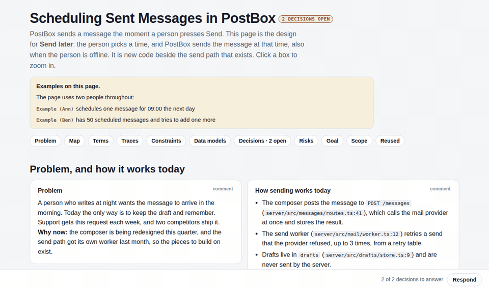
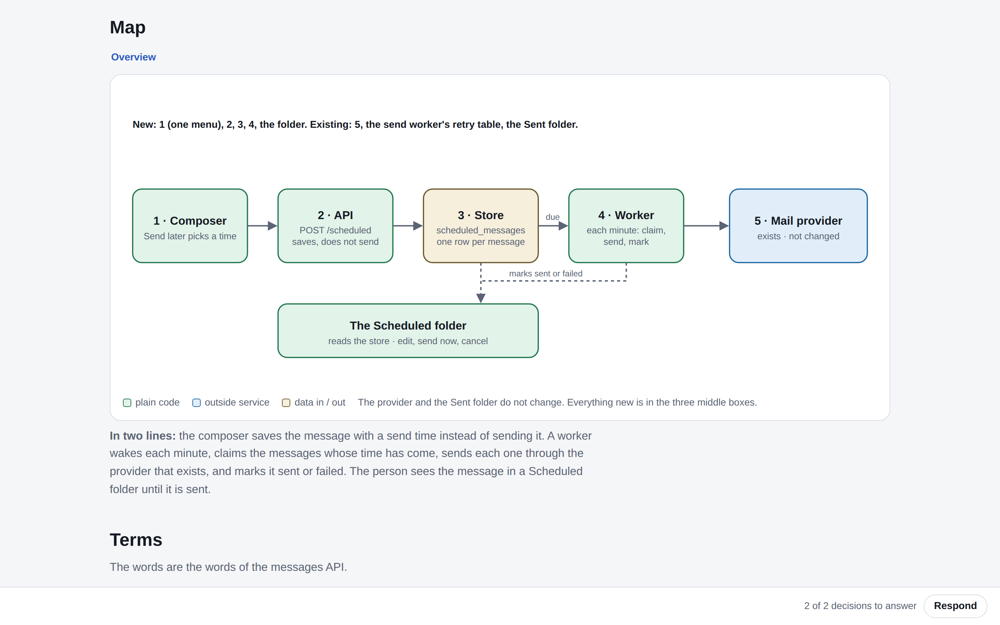

<div align="center">

# visual-plan

*The design of one change, on one interactive page. See it, answer it, lock it.*

[](SKILL.md)
[](#installation)
[](#installation)
[](#the-pack)
[](LICENSE)

⭐ If it saves you from one 10-page plan, star it on GitHub.

[Features](#features) • [Installation](#installation) • [Usage](#usage) • [How it works](#how-it-works) • [Example](#example)



</div>

Coding agents got good at building. Now they write 10-page plans, and the two decisions that are actually
yours are buried on page 7. **visual-plan** is an agent skill that writes the design for one change as a
single self-contained HTML page: a map of the target design you can click into, your open decisions as
controls on the part they change, and a lock. The implementation plan (tasks, files, tests) comes after
the lock, as a separate document.

## Features

- **Zoomable map of the target design.** One overview diagram; click a box to zoom in (map → zoom → detail), with input, inside, output, and one real example at each level.
- **Only your decisions, as controls.** Each open decision has its context, one-line options with the recommendation first, and a panel per option (how, gains, costs, effort, reversible). Nothing is preselected.
- **Respond and Lock.** One button returns every pick, struck row, and comment as a single markdown message. The Lock button appears only when no decision is open.
- **Plain words, linted.** Prose follows ASD-STE100 Simplified Technical English, and the pack checks it, along with "no code in the plan" and retired terms.
- **One file.** The output is one self-contained `plan.html`: no network, no build, no framework. Open it from disk, host it anywhere, or drop it into an artifact.
- **Design, not tasks.** Built around the target state. No task lists, no code sketches, no who-does-what.

## Installation

With the [skills](https://skills.sh) CLI, for any supported agent:

```bash
npx skills add AlmogBaku/visual-plan
```

Or clone it into your agent's skills folder. For Claude Code:

```bash
git clone https://github.com/AlmogBaku/visual-plan ~/.claude/skills/visual-plan
```

For Codex and other agents, clone it wherever your agent loads skills from. The entry point is `SKILL.md`.

> [!NOTE]
> The pack needs only [Node.js](https://nodejs.org). There is nothing to `npm install`: the one parser it uses (js-yaml) is vendored.

## Usage

Ask your agent for it by name, in the session where you are designing a change:

```text
/visual-plan for adding "send later" to the composer
make a visual plan for moving auth to the new gateway
```

The agent reads the code the change touches, writes `plan.yaml`, packs it, and hands you the page with
the list of open decisions. You pick options and leave comments on the page, press **Respond**, and paste
the markdown it gives you back into the chat; the agent answers there first, then updates the page. When
nothing is open, you lock it, and only then does the implementation plan get written.

> [!TIP]
> Planning skills can call it too. Any skill that wants an interactive brief can ask visual-plan for the page and name where the locked HTML is saved.

### The pack

The agent writes data, never HTML. The pack lints the content file and composes it with the runtime:

```bash
node runtime/pack.mjs plan.yaml                  # → plan.html
node runtime/pack.mjs plan.yaml --out page.html  # choose the output file
node runtime/pack.mjs plan.yaml --strict         # warnings fail the build
```

It also accepts `plan.json`, or `plan.js` with `window.PLAN = {...}`.

## How it works

A page is a list of blocks. The core blocks are always present, in this order:

| Block | Holds |
|---|---|
| **opening** | The change and the place, in a few words, and what this page is |
| **problem** | What breaks, for whom, why now, and only the parts of today's code the plan replaces |
| **map** | The overview diagram of the target design, as a node tree, with a two-line walkthrough |
| **decisions** | Settled decisions as a table; open decisions as questions with options |
| **goal** | The acceptance checks |
| **scope** | What is out |

Extras appear only when they have content: examples, design reference, terms, traces, constraints, data
models, risks and behaviour changes, reused parts.

A page has two states. **Open**: one or more decisions wait for you, and the Respond sheet has no Lock.
**Locked**: every decision is settled and dated. A plan moves from open to locked by your answers, never
by the agent's choice, and a change after the lock reopens it.

The full contract lives in the skill:

```text
SKILL.md                  what the page is and is not, the steps, the two states
references/sections.md    each block: what it holds, and the mistake it exists to prevent
references/nodes.md       the node tree and its views: diagram, ports, calls, machine, table, options, section
references/words.md       the STE writing rules and the badge vocabulary
runtime/                  visualplan.css, visualplan.js, and pack.mjs (lint + compose)
```

## Example

`examples/` holds a full synthetic plan: **Send later** for a made-up mail app, PostBox, with two open
decisions. Pack it and open it:

```bash
node runtime/pack.mjs examples/example.yaml
open examples/example.html      # xdg-open on Linux
```

<p align="center"></p>

---

<div align="center">

Made by [@AlmogBaku](https://github.com/AlmogBaku) · from the talk *FML. My Plan Slopped to 10 Pages: Visual Plans to the Rescue*

</div>
